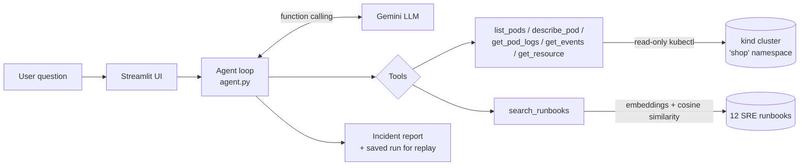

# 🩺 Pod Doctor: an agentic AI assistant for troubleshooting Kubernetes

Pod Doctor is an **AI agent** that troubleshoots a Kubernetes cluster the way an on-call SRE would. You ask a question in plain English ("Why is payment-api crashing?"). The agent then decides for itself which read-only `kubectl` tools to run, collects evidence, looks up the matching fix in a runbook knowledge base using **RAG**, and writes an incident report with root causes and exact fixes.

The demo cluster runs a small "shop" made of microservices: **1 healthy service and 6 services broken in 6 different real-world ways.**

| Service | What's broken | Kubernetes symptom |
|---|---|---|
| web-frontend | nothing (healthy baseline) | Running 2/2 |
| payment-api | required env var `DATABASE_URL` missing | CrashLoopBackOff (exit 1) |
| inventory-service | typo in image tag (`alpne`) | ImagePullBackOff |
| report-worker | memory limit 100Mi, needs ~250Mi | OOMKilled (exit 137) |
| auth-service | references a ConfigMap that doesn't exist | CreateContainerConfigError |
| search-api | requests 32 CPU cores | Pending (Unschedulable) |
| orders-api | readiness probe on wrong port | Running but **0/1 Ready** (the sneaky one) |

## Architecture



**The agent loop (ReAct: reason, then act):** the LLM sees the question and the 6 tool descriptions → it requests tool calls → we run them and send back the results → this repeats until the LLM has enough evidence → it writes the final report. The model chooses which tools to call and in what order. The investigation path is never hard-coded.

## Project structure

```
app.py                  Streamlit web UI (cluster health table + live agent trace + report)
pod_doctor/
  agent.py              the agent loop (Gemini function calling, step limit, run saving)
  tools.py              tool registry: descriptions + JSON schemas the LLM sees
  k8s_tools.py          read-only kubectl wrappers with input validation
  rag.py                RAG retrieval: Gemini embeddings (TF-IDF offline fallback)
  config.py             settings from .env
  cli.py                terminal version of the agent
knowledge_base/         12 SRE runbooks (the RAG documents)
cluster/manifests/      the broken "shop" (1 healthy + 6 broken deployments)
cluster/solutions/      reference fixes, to show the "after" state
scripts/cluster.py      create / status / fix / reset / delete the demo cluster
scripts/snapshot.py     record the cluster for the deployed website (snapshot mode)
data/                   cluster_snapshot.json lives here after you record it
DEPLOY.md               step-by-step guide to a public URL (Streamlit Community Cloud)
tests/                  offline tests using simulated kubectl output
EXPLAINER.md            presenter's guide: how every part works + likely viva questions
runs/                   every investigation is saved here and can be replayed
```

## Setup on Windows (about 15 minutes, once)

**1. Install the tools** (in PowerShell):
```powershell
winget install Docker.DockerDesktop
winget install Kubernetes.kind
winget install Kubernetes.kubectl
```
Start **Docker Desktop** and wait until it says it's running. Then **open a new terminal** so the new tools are on PATH. You also need Python 3.10 or newer.

**2. Python environment** (in the project folder):
```powershell
python -m venv .venv
.venv\Scripts\activate
pip install -r requirements.txt
```

**3. API key:** get a free key at https://aistudio.google.com/apikey, then:
```powershell
copy .env.example .env
notepad .env        # paste the key into GEMINI_API_KEY
```

**4. Create the broken cluster:**
```powershell
python scripts/cluster.py up
```
The first run takes a few minutes because it downloads images. You should see `web-frontend` Running and the other services broken.

## Running it

```powershell
streamlit run app.py
```
Click a preset question, or type your own. To use the terminal version instead:
```powershell
python -m pod_doctor.cli "Why is report-worker restarting?"
```

## Tests (no cluster or API key needed)

```powershell
python tests/test_pod_doctor.py
```
There are 25 checks: the tools parse each failure type correctly, injection attempts are rejected, Secret values stay hidden, RAG retrieves the right runbook for each of the 6 failures, the citation check and self-review catch ungrounded reports, and snapshot mode replays the recorded cluster correctly.

## Demo script (for the presentation)

1. Show the **Cluster health** table: 6 red or yellow services. Point out that orders-api says *Running*, but that hides a problem.
2. Click **"Diagnose every unhealthy pod..."**. Talk through the **agent trace** as it appears: it lists pods, chooses what to inspect, reads crash logs, retrieves runbooks.
3. Show the **incident report**: evidence, root cause, exact YAML fix and runbook citation for each service.
4. Apply a fix: `python scripts/cluster.py fix payment-api`. Click **Refresh**, and the pod turns green.
5. Reset for the next run: `python scripts/cluster.py reset`.

**Backup plan:** every run is saved in `runs/`. If the Wi-Fi or the API fails during the demo, use **Replay a saved run** in the sidebar. **Do one full rehearsal before the evaluation so there's a run saved.**

## Troubleshooting

| Problem | Fix |
|---|---|
| `kind`/`kubectl` not found | Open a new terminal after `winget install`. |
| "Docker is installed but not running" | Start Docker Desktop. |
| `404 model not found` or `503 busy` | The agent switches to the backup models in `FALLBACK_MODELS` automatically. To change the main one, set `GEMINI_MODEL` in `.env` to a current Flash model from https://ai.google.dev/gemini-api/docs/models |
| `429` quota errors | Free-tier rate limit. The agent retries automatically; wait a minute, or ask about one service instead of all of them. |
| Pods stuck in `ContainerCreating` | Images are still downloading. Wait, then run `python scripts/cluster.py status`. |
| Retrieval backend shows "tf-idf" | The embedding call failed (no key or no network). RAG still works with keyword vectors. |

## Deploying to a public URL

See **[DEPLOY.md](DEPLOY.md)**. You record a snapshot of the real cluster with `python scripts/snapshot.py`, push to GitHub, and deploy free on Streamlit Community Cloud. On the website the agent, Gemini and RAG run live, the tools read the recorded cluster data, and an access code protects your API key.

## Safety design

The agent is **read-only by construction**. It can only run `kubectl get`, `describe` and `logs`. Every name the model passes in is validated (so it can't inject commands), every call is pinned to one kube context, and Secret values are never shown to the model. Fixes are *recommended* to a human, never applied automatically.

## Clean up
```powershell
python scripts/cluster.py down
```
